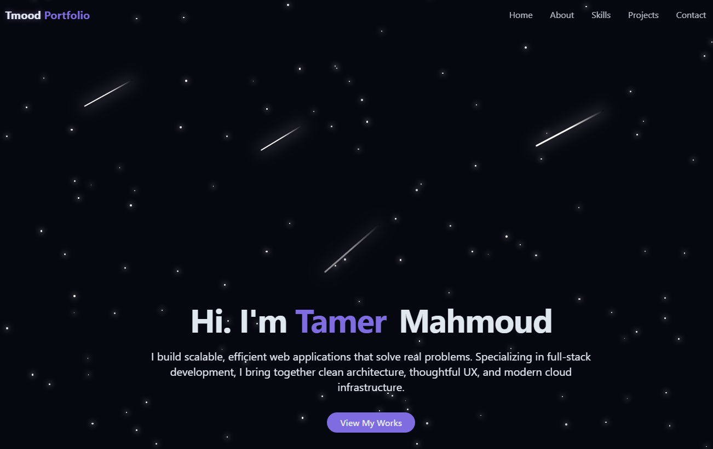
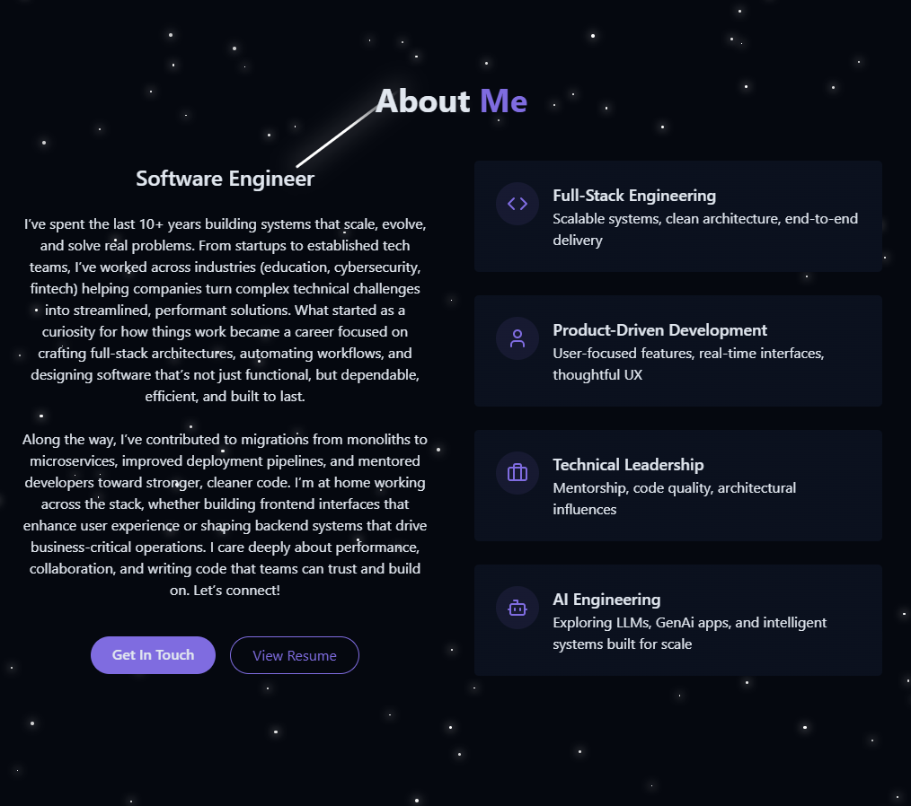
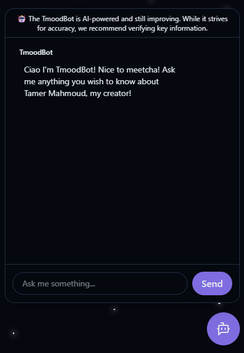

# 🤖 Software Engineer Portfolio with AI Chatbot

A fully responsive developer portfolio demonstrating full-stack engineering, UI polish, and AI-powered features. Built with React, Vite, and Tailwind CSS, the site emphasizes performance, clean UX, and real-world integrations, including a custom AI chatbot trained on resume, GitHub, and LinkedIn content.

---

## 🌐 Live Demo

👉 [https://vite-react-portfolio-lime.vercel.app/](https://vite-react-portfolio-lime.vercel.app/)

---

## ✨ Features

* Lightning-fast React and Vite front end
* Custom AI chatbot using OpenAI and embedding-based retrieval
* Knowledge base pipeline built in Python and Node.js
* Theme toggle with light and dark modes
* Responsive layout with Tailwind CSS
* Animated transitions and section-based navigation
* Starry animated background with occasional shooting meteors in dark mode

---

## 🛠️ Tech Stack

<div align="center">

<table>
  <tr>
    <td align="center" width="240">
      <br/>React
    </td>
    <td align="center" width="240">
      <br/>Vite
    </td>
    <td align="center" width="240">
      <br/>Tailwind CSS
    </td>
    <td align="center" width="240">
      <br/>Node.js
    </td>
  </tr>
  <tr>
    <td align="center" width="240">
      <br/>JavaScript
    </td>
    <td align="center" width="240">
      <br/>Python
    </td>
    <td align="center" width="240">
      <br/>OpenAI API
    </td>
    <td align="center" width="240">
      <br/>Git
    </td>
  </tr>
</table>

</div>

---

## 🧠 What This Project Demonstrates

* Building and deploying a production-ready personal portfolio
* Integrating AI features into a real user-facing application
* Designing a retrieval-based chatbot using embeddings
* Coordinating frontend, backend, and data pipelines
* Emphasizing performance, UX clarity, and maintainable structure

---

## 💻 Running Locally

### Prerequisites

* Node.js 18+ (Node 20 recommended)
* OpenAI API key
* Python 3.10+ (only required to regenerate embeddings)

---

### Environment variables

Create a file named `.env.local` at the project root:

```bash
OPENAI_API_KEY=sk-...
```

Do not expose the key via Vite client-side environment variables.

---

### 🧠 Run Knowledge Base Scripts (optional)

Only required if you want to regenerate embeddings.

```bash
# Create virtual environment
python -m venv venv

# macOS or Linux
source venv/bin/activate

# Windows
source venv/Scripts/activate

# Install Python dependencies
pip install openai tiktoken python-dotenv

# Build knowledge base
node scrape_github.mjs
python combine_knowledge.py
python embed_knowledge.py
```

Expected output:

```
knowledge_base/tamer_knowledge_base_chunk.json
```

---

### 🚀 Start the app

#### Option A: Recommended (API + UI)

```bash
npm install
npx vercel dev
npm run dev
```

The UI runs on `http://localhost:5173` and the API on `http://localhost:3000`.

Ensure `vite.config.js` proxies API calls:

```js
export default {
  server: { proxy: { '/api': 'http://localhost:3000' } },
};
```

---

#### Option B: UI only

```bash
npm install
npm run dev
```

The chatbot will not function unless the API is running.

---

### Optional: production build preview

```bash
npm run build
npx vercel dev --prebuilt
```

---

## 📁 Project Structure

| Path              | Description                       |
| ----------------- | --------------------------------- |
| `/src`            | React components and layout       |
| `/api`            | Serverless chat API handler       |
| `/knowledge_base` | Chatbot scripts and context files |
| `/public`         | Static assets                     |

---

## 👀 Screenshots

<p float="left">
  
  
  
</p>

---

## 📫 Contact

If you have questions about this project or want to discuss implementation details, feel free to reach out via GitHub or LinkedIn.
