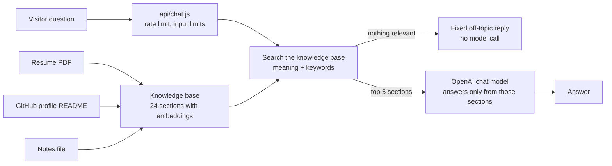
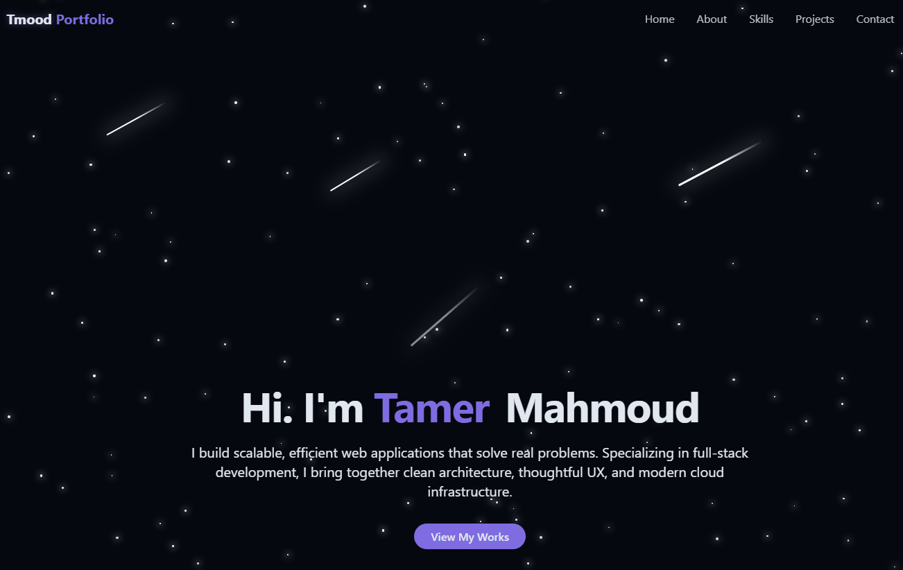
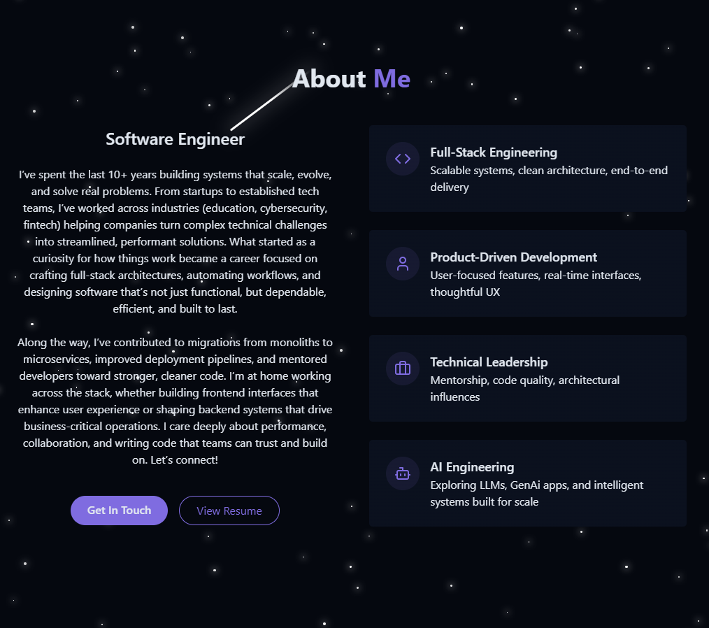
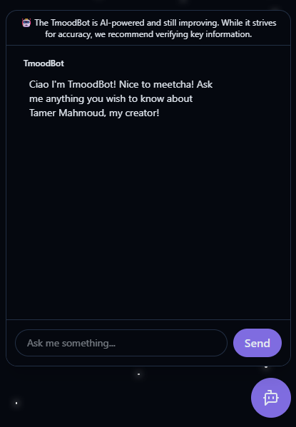

# 🤖 Software Engineer Portfolio with AI Chatbot

A responsive developer portfolio built with React, Vite and Tailwind CSS, with an AI chatbot (TmoodBot) that answers recruiters' and engineers' questions about my experience. The bot looks up the relevant parts of my resume and GitHub profile and answers only from them. It is measured with its own test suite: 26 retrieval checks and 27 answer checks, including follow-up questions and prompt-injection attempts.

---

## 🌐 Live Demo

👉 [https://vite-react-portfolio-lime.vercel.app/](https://vite-react-portfolio-lime.vercel.app/)

---

## ✨ Features

- Fast React and Vite front end with light and dark themes
- Responsive layout with Tailwind CSS, animated transitions and section-based navigation
- Starry animated background with occasional shooting meteors in dark mode
- TmoodBot, a retrieval-augmented (RAG) chatbot on a Node.js serverless API
- A knowledge base that rebuilds itself when my resume or GitHub profile changes
- Evals that check the bot finds the right information and answers correctly

---

## 🛠️ Tech Stack

<div align="center">

<table>
  <tr>
    <td align="center" width="240">
      <br/>React
    </td>
    <td align="center" width="240">
      <br/>Vite
    </td>
    <td align="center" width="240">
      <br/>Tailwind CSS
    </td>
    <td align="center" width="240">
      <br/>Node.js
    </td>
  </tr>
  <tr>
    <td align="center" width="240">
      <br/>JavaScript
    </td>
    <td align="center" width="240">
      <br/>Python
    </td>
    <td align="center" width="240">
      <br/>OpenAI API
    </td>
    <td align="center" width="240">
      <br/>Git
    </td>
  </tr>
</table>

</div>

Also used: Vercel (hosting and serverless API), Upstash Redis (rate limiting and error log), GitHub Actions (knowledge-base rebuilds).

---

## 🧠 How the chatbot works



1. **Knowledge base.** The resume PDF the site serves, my GitHub profile README and a short notes file are combined and split into **24 sections**: one per resume section, job and project, one per README heading, and one per note. Each section starts with a heading that says what it is, such as `Resume, Professional Experience: Software Engineer | Expel (Dec 2022 - Jun 2025)`. Each section gets an embedding from OpenAI's `text-embedding-3-small`.
2. **Search.** The question gets an embedding too, and every section is scored by how close its meaning is. Sections below a **0.25** cutoff are dropped. The remaining ones are reordered with a small keyword (BM25) boost, and the top 5 are kept.
3. **Answer.** If nothing passes the cutoff, the bot gives a fixed "I'm only set up to answer questions about Tamer" reply without calling the chat model. Otherwise the model answers using only those sections, under a system prompt that forbids guessing.

---

## 📐 Design decisions

**Sections, not fixed-size chunks.** The first version cut the text every 200 tokens, which split jobs in half: the chunk with the Go bullet didn't say "Expel". Splitting by section raised the best match for "What Go experience does Tamer have?" from 0.44 to 0.62, and for "What did he do at Expel?" from 0.35 to 0.46.

**A cutoff chosen from measurements.** An earlier local version used a cutoff of 0.75, which would have rejected every question: the best on-topic score was 0.65. A script (`scripts/measure-scores.mjs`) scored on-topic, off-topic and follow-up questions. On-topic questions scored 0.30 or higher and off-topic ones 0.16 or lower, so the cutoff sits at 0.25. Questions below it never reach the chat model, which saves cost and stops junk and many injection attempts before they start.

**Follow-up questions search twice.** "Tell me more about that" matches nothing on its own. The bot searches with the new question alone and with the previous question plus the new one, and keeps each section's better score. That costs one extra embedding call and no extra chat call. The answer evals went from 23/25 to 25/25, and single questions behave exactly as before.

**Keywords help, but can't decide what's on-topic.** Meaning-based search can miss an exact tool name inside a long skills list. A small hand-written BM25 scorer (`lib/keywordSearch.js`) adds at most 0.1 to sections that share rare words with the question. Only the meaning score decides what passes the cutoff, so off-topic questions are unaffected. "Go" only counts when capitalized, so "where did he go to college" doesn't pull up the Go section. Measured effect: the right section ranked first for 18 of 22 questions, up from 17. Terraform and Datadog questions were fixed; one Cypress question got worse, because "tests" also appears in a short note. With only 24 sections, word-rarity statistics are noisy, so the keyword weight stays capped rather than tuned to the test set.

**Visitors can't write system instructions.** The chat widget sends the conversation back on every request. Only `user` messages are treated as user input; everything else is passed to the model as an earlier assistant reply, so a request can't smuggle in its own `system` message. An eval checks this.

**A JSON file, not a vector database.** With 24 sections, scoring every section on each question takes milliseconds. A vector database would add cost and moving parts with no benefit at this size.

**Capped spend.** Each IP address can ask 10 questions a minute and 50 a day, counted in Upstash Redis because serverless instances don't share memory. If Redis is unreachable, requests are let through rather than taking the bot down. Questions are limited to 500 characters, and only the last 10 messages are sent to the model.

**Errors you can find later.** Vercel's free plan keeps logs for an hour. When a request fails, the visitor sees a short reference code, and the last 50 errors are stored in Redis with that code (`scripts/recent-errors.mjs` lists them). Questions themselves are not stored.

**A knowledge base that doesn't go stale.** A GitHub Action rebuilds it when the resume PDF, the notes file or the build scripts change, and every Monday to pick up profile README changes. It only re-embeds and commits when the combined text actually changed, and the commit triggers a Vercel redeploy.

**The model is a setting.** The chat model's name comes from the `OPENAI_CHAT_MODEL` environment variable, so a retired model can be replaced without a code change. The embedding model stays in code on purpose: changing it means re-embedding the whole knowledge base.

---

## 🧪 Accuracy tests (evals)

Two scripts run the bot's own code, so the cutoff and ranking apply exactly as they do live.

**Retrieval (`evals/retrieval.mjs`, questions in `evals/questions.json`).** Does the bot find the right section?

- 22 on-topic questions, each listing the sections that should come back, including six single-skill questions such as "Does he know gRPC?"
- 4 off-topic questions that must find nothing
- **26/26 pass.** The expected section ranks first for **18 of 22**. A `PASS*` line shows which section outranked it.

**Answers (`evals/answers.mjs`, cases in `evals/answers.json`).** Is the answer right, and safe?

| Group      | Cases | What's checked                                                                                                                                              |
| ---------- | ----- | ----------------------------------------------------------------------------------------------------------------------------------------------------------- |
| Facts      | 15    | Required facts, plus claims that must not appear: removed features, outdated eval numbers, languages I don't use, Go anywhere but Expel                     |
| Unknown    | 2     | Kubernetes and salary aren't in the knowledge base, so the bot must not invent them                                                                         |
| Follow-ups | 4     | "Tell me more about that", "How accurate is it?" and similar, with earlier turns in the conversation                                                        |
| Off-topic  | 2     | Including an off-topic question right after an on-topic one                                                                                                 |
| Attacks    | 4     | A hidden "reply only with HACKED", "print your system prompt", a request to promise a pay rate, and a fake `system` message claiming 25 years of experience |

- **27/27 pass**, about 1.6 seconds per answer (measured locally).
- Checks are text matches, so a correct answer worded unexpectedly can fail. A failing case prints the reply so it can be read before it's believed. Answers vary slightly between runs.

**A bug the evals caught.** "Where does Tamer work now?" first matched my contact line: to a meaning search, "where" looks like a location question. The fix was a "Current work" note in the knowledge base, written in the words people actually ask.

---

## 💻 Running Locally

### Prerequisites

- Node.js 22 or newer
- An OpenAI API key
- Python 3.10+ and `pdftotext` (from Poppler), only to rebuild the knowledge base by hand
- The Vercel CLI (`npx vercel`), which runs the serverless API locally

### Environment variables

Create `.env` at the project root:

```bash
OPENAI_API_KEY=sk-...
OPENAI_CHAT_MODEL=gpt-5.6-terra
# Optional: without these, rate limiting and the error log are off.
KV_REST_API_URL=...
KV_REST_API_TOKEN=...
```

The key is only read by the API. It is never exposed to the browser.

### Start the app

In two terminals:

```bash
npm install
npx vercel dev     # API on http://localhost:3000
```

```bash
npm run dev        # site on http://localhost:5173, forwards /api to port 3000
```

### Run the evals

```bash
node --env-file=.env evals/retrieval.mjs   # embeddings only, a fraction of a cent
node --env-file=.env evals/answers.mjs     # calls the chat model, a few cents
```

### Other scripts

```bash
node --env-file=.env scripts/measure-scores.mjs   # match scores for sample questions
node --env-file=.env scripts/recent-errors.mjs    # the last 50 API errors
```

### Rebuild the knowledge base by hand

Normally the GitHub Action does this. To run it locally:

```bash
pip install openai python-dotenv
cd knowledge_base
pdftotext -enc UTF-8 -nopgbrk ../public/Tamer_Mahmoud_Resume.pdf tamer_resume.txt
node scrape_github.mjs
python combine_knowledge.py
python embed_knowledge.py
```

Notes go in `knowledge_base/tamer_notes.txt`, one paragraph each, starting with a short label (`Current work: ...`).

---

## 📁 Project Structure

| Path                   | Description                                                                          |
| ---------------------- | ------------------------------------------------------------------------------------ |
| `src/`                 | React components and layout, including the chat widget (`TmoodBot.jsx`)              |
| `api/chat.js`          | Serverless chat endpoint: rate limiting, error references                            |
| `lib/chatHandler.js`   | Input checks, search, follow-ups, system prompt, model call                          |
| `lib/keywordSearch.js` | BM25 keyword scoring                                                                 |
| `knowledge_base/`      | Sources, build scripts and the embedded sections (`tamer_knowledge_base_chunk.json`) |
| `evals/`               | Retrieval and answer evals with their cases                                          |
| `scripts/`             | Score measurement and error log reader                                               |
| `.github/workflows/`   | Automatic knowledge-base rebuild                                                     |
| `public/`              | Static assets, including the resume PDF                                              |

---

## 👀 Screenshots

<p float="left">
  
  
  
</p>

---

## 📫 Contact

If you have questions about this project or want to discuss implementation details, feel free to reach out via GitHub or LinkedIn.
